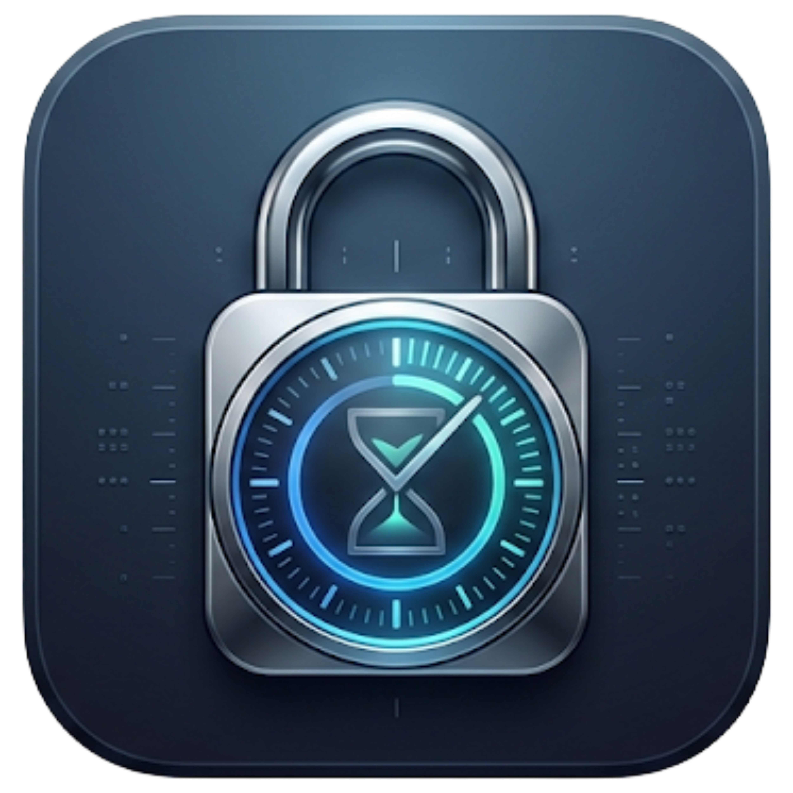

<p align="center">
  
</p>

<h1 align="center">LockedIn</h1>

<p align="center">
  <strong>Focus on what matters.</strong>
</p>

<p align="center">
  A native, distraction-resistant goal, task, deadline countdown, and focus-timer application built with pure SwiftUI for macOS.
</p>

<p align="center">
  <a href="https://swift.org"></a>
  <a href="https://www.apple.com/macos"></a>
  <a href="https://developer.apple.com/xcode/swiftui/"></a>
  <a href="#license"></a>
  <a href="#offline-first"></a>
  <a href="https://github.com/K-692/LockedIn/releases/latest"></a>
  <a href="https://github.com/K-692/LockedIn/releases/download/v1.0.0/LockedIn-Universal.dmg"></a>
</p>

<p align="center">
  <a href="https://github.com/K-692/LockedIn/releases/download/v1.0.0/LockedIn-Universal.dmg">
    
  </a>
</p>

<p align="center">
  <sub>Compatible with Apple Silicon (M1/M2/M3/M4) & Intel Macs (macOS 13.0+)</sub>
</p>

---

## 🌟 Overview

**LockedIn** is engineered to eliminate distraction and preserve relentless forward momentum on the outcomes that define your career, education, craft, and personal life.

While flexible enough to manage high-stakes long-term efforts like PhD dissertations, book manuscripts, engineering roadmaps, licensing exams, or athletic training blocks, **LockedIn** enforces a strictly **domain-neutral architecture**. You will never find hardcoded academic assumptions or rigid hierarchies. The terminology adapts seamlessly to whatever outcome you choose to pursue.

```
Goal ──▶ Categories ──▶ Tasks & Subtasks ──▶ Focus Timer & Countdown
```

---

## ✨ Core Highlights

### 🎯 Domain-Neutral Data Architecture
- **Goal**: Any high-order outcome (research, product launch, marathon training, examination prep).
- **Target Deadline**: The definitive date and time for achieving the goal, driving live countdowns.
- **Category**: Flexible, user-colored grouping of tasks.
- **Milestone**: High-significance checkpoints that visually anchor your journey.
- **Task & Subtask**: Granular, state-bearing work items with optional deadlines and priorities.
- **Overall Progress**: Mathematically computed, weighted completion across all leaf tasks.

### 🧭 Exactly Three Primary Navigation Tabs
LockedIn maintains a clean, distraction-free environment organized into strictly three primary views:
1. **Dashboard**: Live target countdown, overall progress ring, active task showcase, Pomodoro focus timer, upcoming tasks feed, and milestone tracker.
2. **Add Tasks**: Hierarchical goal sidebar, category accordions with progress rings, interactive task rows, subtasks, milestone tagging, and editing forms.
3. **Settings**: Target deadline recalibration, Light/Dark/System appearance switcher, custom notification schedules, menu bar extra controls, Pomodoro cadence tuning, launch-at-login, and JSON backup/restore.

### 🌓 Fluid Theme & Appearance Engine
- Three appearance preferences: **System** (follows macOS dynamically), **Light**, and **Dark**.
- Persisted locally with instant UI update across the entire app and menu bar without requiring a restart.
- Designed with high-contrast accessibility and semantic macOS styling.

### ⏱️ Persistent Menu Bar Extra
- Live target countdown pill (`e.g. 142d`) and progress percentage right in your macOS menu bar.
- Quick popover access to a mini-dashboard, Pomodoro timer controls, and active task list.
- Works continuously even if the main window is closed.

### 🔒 100% Offline-First & Private
- Zero cloud accounts, zero telemetry, zero data brokers.
- Atomic JSON persistence stored locally in `~/Library/Application Support/LockedIn/`.
- Full backup export and restore in human-readable JSON.

### 🚀 Neutral Onboarding Experience
- Guided 3-step setup explaining how to define goals, break down tasks, and stay locked in.
- Set a goal name and target deadline immediately, or skip to explore.

---

## 🏗️ Architecture

```
LockedIn/
├── Package.swift                    # Swift Package Manager manifest
├── LockedIn.xcodeproj/              # Native Xcode Project (macOS 13.0+)
├── icon/
│   └── icon.png                     # Master 1024x1024 icon
├── LockedIn/
│   ├── App/
│   │   └── LockedInApp.swift        # @main entry point, Scene & MenuBarExtra
│   ├── Models/
│   │   ├── Goal.swift               # Root outcome model & progress logic
│   │   ├── Category.swift           # User-defined grouping model
│   │   ├── Task.swift               # Tasks, subtasks, milestones, statuses
│   │   ├── FocusSession.swift       # Pomodoro session state & timer options
│   │   └── AppSettings.swift        # Appearance, notifications, preferences
│   ├── ViewModels/
│   │   └── AppViewModel.swift       # Central state store & persistence broker
│   ├── Views/
│   │   ├── ContentView.swift        # Master container with 3 primary tabs
│   │   ├── Dashboard/
│   │   │   └── DashboardView.swift  # Countdown, progress ring, active task
│   │   ├── AddTasks/
│   │   │   ├── AddTasksView.swift   # Category accordions, task rows
│   │   │   └── FormSheets.swift     # Modal builders for goals/categories/tasks
│   │   ├── Settings/
│   │   │   └── SettingsView.swift   # Appearance, timer, notifications, backup
│   │   ├── MenuBar/
│   │   │   └── MenuBarView.swift    # Lightweight menu bar popover
│   │   ├── Onboarding/
│   │   │   └── OnboardingView.swift # First-launch guided configuration
│   │   └── Shared/
│   │       ├── DesignSystem.swift   # Tokens, ProgressRing, CountdownDisplay
│   │       └── FocusTimerView.swift # Circular Pomodoro sweep timer
│   ├── Services/
│   │   ├── PersistenceService.swift # Atomic JSON read/write & backup engine
│   │   └── NotificationService.swift# UserNotifications dispatcher
│   ├── Assets.xcassets/             # AppIcon, MenuBarIcon, AccentColor
│   └── Info.plist                   # App configuration & bundle metadata
├── flow.md                          # Technical architecture & state machine
└── README.md                        # Documentation & contribution guide
```

---

## ⚡ Quick Start & Installation

### Option 1: Direct Download (Recommended for all Mac users)
1. Download **[LockedIn-Universal.dmg](https://github.com/K-692/LockedIn/releases/download/v1.0.0/LockedIn-Universal.dmg)** (Universal binary for both Apple Silicon and Intel Macs).
2. Open the downloaded `.dmg` file.
3. Drag **LockedIn.app** into your **Applications** folder.
4. Launch **LockedIn** from Applications or Spotlight!

*(If macOS displays an unverified developer prompt on first open, right-click `LockedIn.app` and choose **Open**, or allow it in System Settings > Privacy & Security).*

---

### Option 2: Build the Universal DMG from Source
```bash
git clone https://github.com/K-692/LockedIn.git
cd LockedIn

# Compile universal binary (arm64 + x86_64) and create DMG
./scripts/build_dmg.sh
```

---

### Option 3: Build & Run from Command Line
```bash
# Clone the repository
git clone https://github.com/K-692/LockedIn.git
cd LockedIn

# Build the release executable
swift build -c release

# Launch LockedIn
.build/release/LockedIn
```

---

### Option 4: Open in Xcode
```bash
open LockedIn.xcodeproj
```
Press `Cmd + R` in Xcode to build and run.

---

## 📊 Technical Specifications

| Parameter | Specification |
| :--- | :--- |
| **Minimum Deployment** | macOS 13.0 (Ventura) |
| **Tested On** | macOS Sonoma (14.x) & macOS Sequoia (15.x) |
| **Architecture** | Apple Silicon (arm64) & Intel (x86_64) Universal |
| **Frameworks** | SwiftUI, AppKit, Combine, UserNotifications, UniformTypeIdentifiers |
| **Storage Engine** | Atomic serialized JSON with crash recovery |
| **UI Paradigms** | 3-tab segmented navigation, Glassmorphism, Semantic Colors |

---

## 🤝 Contributing

Contributions make the open-source community an inspiring place to learn, create, and build. Any contributions you make are **greatly appreciated**.

1. Fork the Project
2. Create your Feature Branch (`git checkout -b feature/AmazingFeature`)
3. Commit your Changes (`git commit -m 'feat: Add some AmazingFeature'`)
4. Push to the Branch (`git push origin feature/AmazingFeature`)
5. Open a Pull Request

---

## 📄 License

Distributed under the MIT License. See `LICENSE` for more information.

---

<p align="center">
  Built with ❤️ for focused creators, researchers, engineers, and achievers everywhere.
</p>
